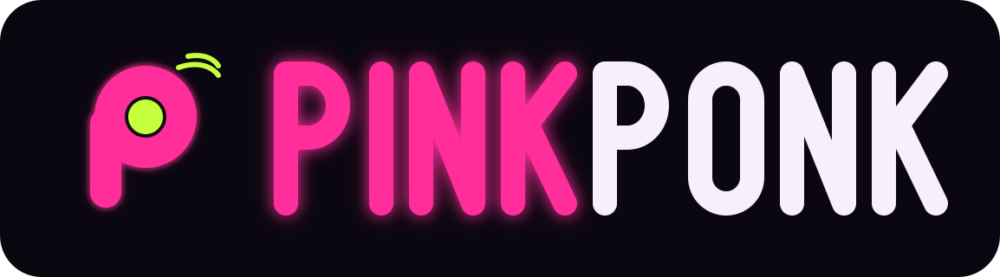

<p align="center"></p>

# PinkPonk

Game ping pong web dengan robot maskot neon: Vs AI, 2 pemain lokal, online 1v1, dan
mode Timing Smash. Tema gelap/terang, 4 sudut kamera, tanpa database, berjalan di
Cloudflare (`pinkponk.my.id`).

## Menjalankan

```
pnpm install
pnpm dev            # web (localhost:5173) + Worker/Durable Object (localhost:8787)
pnpm check          # typecheck + lint + unit test (wajib hijau sebelum PR)
pnpm build && pnpm size   # build produksi + cek budget ukuran
pnpm test:e2e       # Playwright (membangun build E2E dan menjalankan wrangler dev)
```

Node 22 dan pnpm 10. Bila Chromium sudah terpasang di lokasi lain, set
`PW_CHROMIUM=/path/ke/chrome` untuk E2E.

## Struktur

```
apps/web            frontend (Vite + Preact, chunk game Three.js dimuat lazy)
packages/sim        simulasi deterministik: fisika, aturan, AI, timing (TS murni)
packages/protocol   pesan jaringan biner + kontrol JSON tervalidasi
worker/             Cloudflare Worker + Durable Object room online
e2e/                test Playwright
scripts/            budget ukuran, generator ikon/OG
docs/               PRD, desain, arsitektur, QA, security, deploy, logo
```

## Dokumen

- [PRD](docs/PRD.md) — mekanik, mode, POV, fitur, prioritas, keputusan
- [Design system](docs/DESIGN.md) — warna neon, tipografi, robot, motion, logo
- [Arsitektur](docs/ARCHITECTURE.md) — stack, netcode, kompensasi lag, biaya Cloudflare
- [QA](docs/QA.md) — strategi test, skenario E2E, budget
- [Security](docs/SECURITY.md) — threat model dan mitigasi
- [Deploy](docs/DEPLOY.md) — domain, token Cloudflare, CI/CD

## Branch

- `development` — branch kerja, deploy otomatis ke `dev.pinkponk.my.id`
- `production` — hanya lewat PR dari `development`, deploy ke `pinkponk.my.id`
